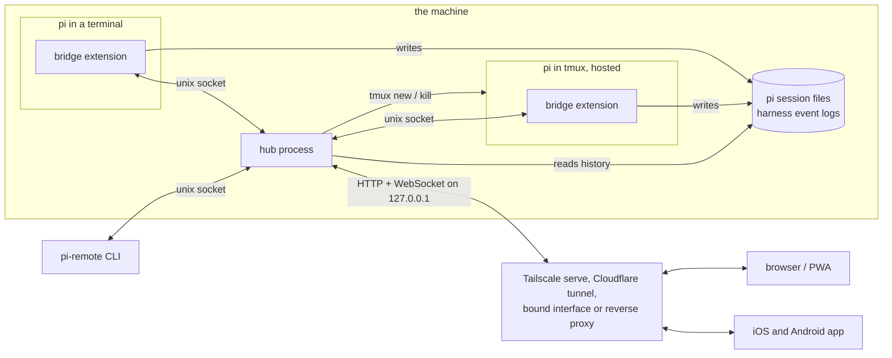
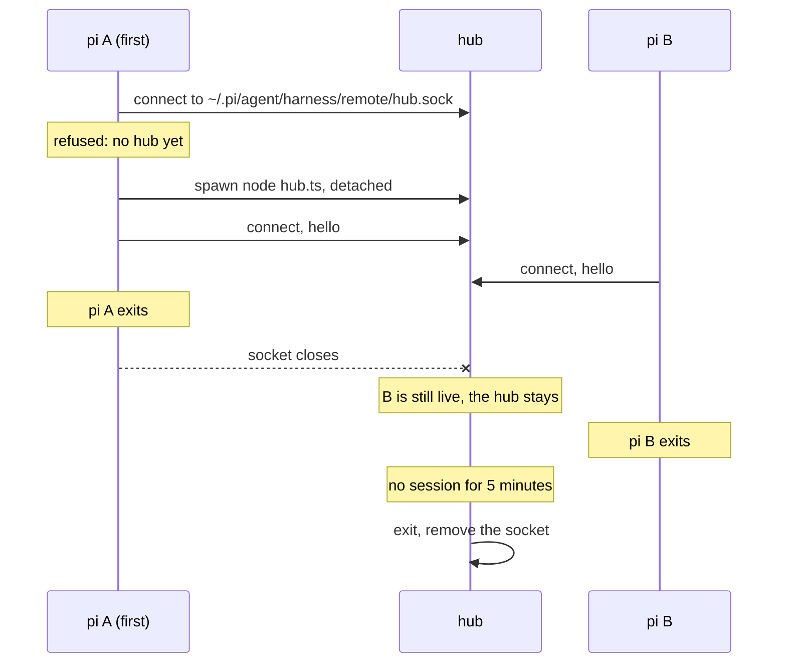
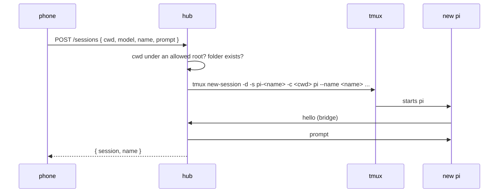
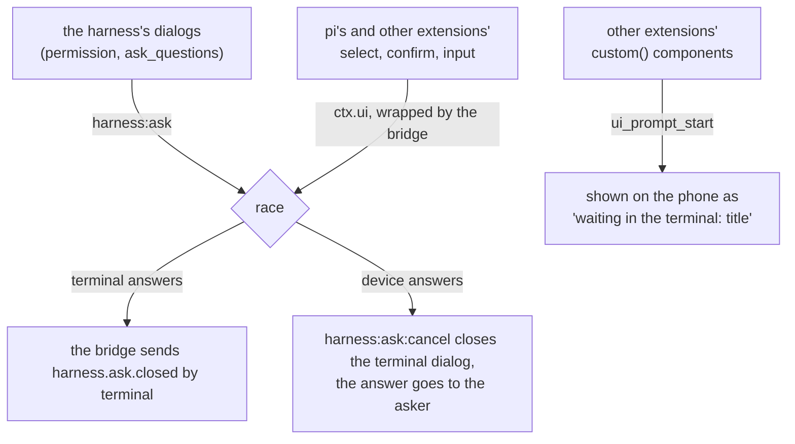

# Remote: your sessions from anywhere

This is the design for reaching pi sessions from a phone, a browser or another terminal, and for keeping sessions running in the background. Nothing here ships yet. The plan lives in [`ROADMAP.md`](../ROADMAP.md#from-anywhere), and this document says how it works and why.

## What it is for

The agent asks for a decision while I am away from the desk, and the run waits until I come back. Most of what I need on the phone is to answer that call, read what happened, and send the next message. The same pieces also let a session run without a terminal attached, which is what a harness on a VPS needs.

Five things should work when this is done:

1. I open `pi` in a terminal as I do today. My phone shows that session live, and I can answer its questions and steer it from there. Whichever side answers a question first wins, and the other side closes its dialog.
2. I close the laptop lid or leave the SSH connection, and a session started in the background keeps working. Later I take it back from a terminal with one command, even in the middle of a run.
3. From the phone I start a new session in a folder I allowed, pick the model, and send the first message.
4. On a VPS, one command sets up the service, and I reach it through Tailscale, a Cloudflare tunnel, or my own reverse proxy with a login page.
5. When a session needs me and I am not at the keyboard, the phone gets a notification. When I am typing in a terminal on that machine, it stays quiet.

## Decisions

| Question                                                       | Decision                                                                                                                                         | Why                                                                                                                                                                                                                                         |
| -------------------------------------------------------------- | ------------------------------------------------------------------------------------------------------------------------------------------------ | ------------------------------------------------------------------------------------------------------------------------------------------------------------------------------------------------------------------------------------------- |
| Build it or use [pi-mobile](https://pi.dev/packages/pi-mobile) | Build it on the kit's contracts, and take pi-mobile's good ideas                                                                                 | pi-mobile forwards pi's `select`, `confirm` and `input` by replacing them on `ctx.ui`. Our permission and question dialogs are `ctx.ui.custom()` components, which it cannot forward. It also has no tasks, rulings, costs or peers to show |
| Who runs the hub                                               | A separate process that the first pi starts, that outlives it, and that exits after 5 minutes with no session                                    | No service to install for the common case, and closing the first terminal does not take the others down. A VPS keeps it up for good with `pi-remote serve`                                                                                  |
| Where a background session runs                                | An interactive `pi` inside a detached tmux session                                                                                               | Taking it back from a terminal is `tmux attach`, mid-run included, and our dialogs draw in the terminal exactly as they do today. See [Hosting a session](#hosting-a-session) for what was weighed                                          |
| How the phone reaches the machine                              | The hub listens on loopback. Tailscale serve, a Cloudflare tunnel, a bound interface or a reverse proxy expose it, with a login the hub provides | Each user picks the reach they trust. The hub never assumes a network is private                                                                                                                                                            |
| The client                                                     | One Expo codebase for the web, iOS and Android. The web build is served by the hub                                                               | One set of screens, and the web build already installs as a PWA. Native builds add push, QR scanning and the camera later                                                                                                                   |
| Starting sessions remotely                                     | Only in folders under the roots set on the Remote settings tab, `~` by default                                                                   | Starting pi in a folder runs code there. It is its own setting, apart from the permission grants                                                                                                                                            |
| The permission mode `full`                                     | Never set from outside the machine                                                                                                               | Kept from the roadmap: a stolen phone must not turn approvals off                                                                                                                                                                           |

## The pieces



| Piece    | What it does                                                                                                                                                                                                                         | Where it lives                                                                                                        |
| -------- | ------------------------------------------------------------------------------------------------------------------------------------------------------------------------------------------------------------------------------------ | --------------------------------------------------------------------------------------------------------------------- |
| Bridge   | An extension in every pi process. It publishes the session's events, answers the hub's snapshot request, runs the commands the hub forwards, and enters the race for every dialog. It starts the hub when none is running            | `@adeildo/pi-remote`, loaded by `@adeildo/pi-harness` like the other pieces                                           |
| Hub      | One process per machine. It keeps the list of live sessions, routes events to clients and commands to sessions, keeps a replay buffer, serves the web app, handles login and pairing, starts hosted sessions and sends notifications | Another entry of `@adeildo/pi-remote`, run as its own Node process                                                    |
| Protocol | The shapes on the wire, their decoders, the version, and the reducers that rebuild a transcript from events. No Node imports and no pi imports, so the hub, the bridge, the web and the native app all use it                        | `@adeildo/pi-remote-protocol`                                                                                         |
| Client   | The screens. It talks only to the hub                                                                                                                                                                                                | `apps/remote`, an Expo app. Not published to npm: its web build is copied into `@adeildo/pi-remote` at release        |
| CLI      | Lists sessions, starts one, takes one back, pairs devices, runs the hub in the foreground                                                                                                                                            | The `pi-remote` bin of `@adeildo/pi-remote`, for a global install. `/remote` inside pi does the same from any session |

### What the hub may import

The hub runs as its own process, so pi's extension loader does not resolve its imports. Pi installs packages without their peers, so `@earendil-works/*` is not on disk next to ours (that is the 5.11.1 bug, see [`scripts/smoke.ts`](../scripts/smoke.ts)). The hub therefore imports only Node's standard library and `@adeildo/pi-remote-protocol`. It reads pi's session files through the documented [session format](https://github.com/earendil-works/pi/blob/main/packages/coding-agent/docs/session-format.md) instead of pi's `SessionManager`.

The hub is TypeScript run by the Node binary that runs pi (`process.execPath`), and pi requires Node 22.19 or newer, where Node strips types by itself. Its code is limited to syntax Node can strip: no `enum`, no parameter properties, no `namespace`. Its package turns on `erasableSyntaxOnly` so `tsc` refuses the rest.

## The hub's lifecycle



- **Start.** On `session_start`, the bridge connects to `hub.sock` under `~/.pi/agent/harness/remote/`. When nothing answers, it spawns the hub with `detached: true` and `stdio: "ignore"` and lets it go, then connects with a short backoff. Two pi processes starting at once both spawn; the hub that binds the socket first wins and the other exits, because binding is the lock. A socket file with no process behind it is removed after a failed connect.
- **Stay.** The hub lives while any session is connected, and while a hosted session exists even if its bridge is reconnecting. With no session for `idleExitMinutes` (5 by default), it exits. `never` keeps it up, which is what a VPS wants.
- **Foreground.** `pi-remote serve` runs the hub attached to the terminal, for systemd or a container. It never exits on idle.
- **Upgrade.** Every hello carries the protocol version and the package version. A hub older than a connecting bridge exits as soon as it has no client mid-request, and the bridges start the new one. Losing the hub loses only the replay buffer: the sessions keep running, the bridges reconnect, and the clients resync from a snapshot. This is why the hub keeps no state of its own beyond devices, credentials and settings, which are files.
- **Web app version.** The hub reads the web build into memory when it starts and serves that copy. `pi update` replaces the files on disk while an old hub is still running, and serving from disk would hand the phone an app that does not match the hub. pi-mobile hit the same problem.

## Sessions

### Two kinds

| Kind             | Who started it                                                        | Taking it back from a terminal                                                                             |
| ---------------- | --------------------------------------------------------------------- | ---------------------------------------------------------------------------------------------------------- |
| Terminal session | You, by running `pi` in any terminal                                  | It is already in that terminal. From another terminal, close it first and open it with `pi --session`      |
| Hosted session   | The hub, because you asked from the phone, the web or `pi-remote new` | `pi-remote attach <name>`, which runs `tmux attach -t pi-<name>`. Detaching (`Ctrl-b d`) leaves it running |

Both kinds load the bridge, so the phone sees no difference. A hosted session is only a terminal session whose terminal nobody is looking at.

### One writer per session

Pi has no lock on a session file. Two processes opened with the same `--session` would both append to it. The bridge adds the lock pi lacks: on `session_start` it registers the session id with the hub, and when another live process already holds it, it says so in the chat and tells you where the session is running (`pi-remote attach <name>`). When the hub is not running, the bridge keeps a lock file next to the event log (`<session>.lock` with the pid) and checks it the same way.

### Starting a session remotely



- **Where.** The hub only starts pi in a folder under one of the roots on the Remote settings tab, `~` by default. It resolves symlinks before checking, so a link out of the root does not count. The folder picker lists the folders under each root, recent session folders first, read from pi's session directories.
- **How.** The hub passes only `--name`, `--model` and `--session` when continuing. Anything else comes from the folder's settings, like any pi you open.
- **Trust.** Pi asks before trusting a project's own extensions, and that question runs before any extension loads, so the bridge cannot forward it. The hub refuses to start a session in a folder pi has not trusted, and says to open it once in a terminal or to trust it from there. A later version can trust it on request after asking on the phone.
- **Continuing a closed session.** The session list includes recent sessions that no process holds. Opening one starts a hosted pi with `--session <id>`.
- **Stopping.** The phone can ask a hosted session to end (`ctx.shutdown()`, which waits for the run to settle) or kill it. A terminal session can only be asked.
- **A worktree per session.** Later: the hub can create a git worktree for a new session, as Claude Code's `--spawn worktree` does.

### Hosting a session

Three ways to run a session nobody is looking at were weighed.

|                                      | Interactive pi in tmux                  | `pi --mode rpc` under the hub                                                                                                                | Sessions inside the hub through the SDK |
| ------------------------------------ | --------------------------------------- | -------------------------------------------------------------------------------------------------------------------------------------------- | --------------------------------------- |
| Take it back from a terminal mid-run | Yes, `tmux attach`                      | No. Pi's terminal cannot attach to an RPC process, so the hub waits for the run to settle, stops it and opens `pi --session` in the terminal | No, same handoff                        |
| Our `custom()` dialogs               | Draw in the terminal and race the phone | Fall back to the plain select and input of `packages/ask-questions/src/rpc.ts`                                                               | Same as RPC, and no terminal at all     |
| Events and dialogs reach the hub     | Through the bridge                      | Through RPC's own stream and its extension UI protocol, with no replacing of `ctx.ui`                                                        | Directly                                |
| A crash takes down                   | One session                             | One session                                                                                                                                  | Every session                           |
| Needs                                | tmux                                    | Nothing                                                                                                                                      | Nothing                                 |

tmux wins because taking a session back mid-run is the point of having it in the background, and because every dialog keeps working on both sides. RPC stays the better host for work nobody will ever attach to, like a scheduled job, and can be added later as a second host behind the same bridge. Without tmux on the machine, the hub can still show and control terminal sessions but starts none.

## The protocol

### Transport

- **Clients and the hub:** HTTP for login, the snapshot, history and files, and one WebSocket per client for everything live. JSON text frames.
- **Bridges and the hub:** the unix socket, one JSON object per line, with the same envelope. Lines split on `\n` only, never with a reader that also splits on U+2028, as pi's RPC documentation warns.

### Envelope

```ts
interface Envelope {
	v: 1;
	kind: "hello" | "event" | "command" | "reply" | "snapshot" | "error";
	/** The session it is about. Absent for hub-level messages. */
	session?: string;
	/** Per session, increasing. A client resumes from the last one it saw. */
	seq?: number;
	/** Pairs a command with its reply. */
	id?: string;
	type: string;
	data: unknown;
	at: number;
}
```

A shape only grows. A field that changes meaning gets a new name, and an incompatible change gets `v: 2`. This is the rule the event log already follows.

### A session's stream

1. The client subscribes to a session with the last `seq` it saw.
2. When the hub still holds every event after that `seq`, it sends them. Otherwise it asks the bridge for a snapshot and sends it, then the events after it.
3. Events follow, in order.

The hub keeps a ring of recent events per session, sized by count (20,000 across the machine, the size pi-mobile settled on). Only the session a client has open streams text deltas and tool output to it. The other sessions send state changes only: started, waiting on you, settled, the title, the cost. Ten busy sessions cost the phone little battery and data.

### The snapshot

What a client needs to draw a session without replaying it:

| Field                               | From                                                        |
| ----------------------------------- | ----------------------------------------------------------- |
| The transcript of the active branch | `ctx.sessionManager.getBranch()`, as pi's message types     |
| The message being streamed, if any  | The bridge's own copy of the partial message                |
| The queue                           | The last `queue_update`                                     |
| Model, thinking level, context use  | `ctx.model`, `ctx.thinkingLevel`, `ctx.getContextUsage()`   |
| Tasks and decisions                 | `TASKS.current()`                                           |
| Rulings of the calls in view        | `RULING.current()` for each call                            |
| Open questions                      | The bridge's list of open asks                              |
| Permission mode                     | The permission feature's state                              |
| Account and quota windows           | `ACCOUNT.current()`                                         |
| Peers in the folder                 | `PEERS.current()`                                           |
| Cost of the session                 | The session's usage totals                                  |
| Who is looking                      | The hub adds the viewers and whether a terminal is attached |

### Event families

**`pi.*`** is pi's own event stream in the shapes of its JSON and RPC modes (`JsonAgentSessionEvent`, see [JSON Event Stream](https://github.com/earendil-works/pi/blob/main/packages/coding-agent/docs/json.md)), so the client follows pi's rules for rebuilding a streamed message and pi's documentation covers them. The bridge subscribes with `pi.on()` and drops the cumulative `partial` fields, as pi's JSON mode does.

| Event                                                     | What the client does with it                                                                                     |
| --------------------------------------------------------- | ---------------------------------------------------------------------------------------------------------------- |
| `pi.agent_start`, `pi.agent_settled`                      | Working, then idle. `agent_settled` is the one that means nothing more will happen                               |
| `pi.message_start`, `pi.message_update`, `pi.message_end` | Build the message from deltas, replace each block on its `*_end`, and replace the whole message on `message_end` |
| `pi.tool_execution_start`, `_update`, `_end`              | One row per call, with its output. Nested calls carry `parentToolCallId`                                         |
| `pi.queue_update`                                         | The steering and follow-up queues                                                                                |
| `pi.compaction_start`, `pi.compaction_end`                | A line in the transcript                                                                                         |
| `pi.auto_retry_start`, `pi.auto_retry_end`                | A line while it waits                                                                                            |
| `pi.session_info_changed`, `pi.thinking_level_changed`    | The header                                                                                                       |
| `pi.model_select`                                         | The header. Pi has no JSON event for it, so the bridge sends one in the same style                               |

**`harness.*`** are the kit's contracts, the things only this harness knows. [Events inside the harness](#events-inside-the-harness) lists what each feature has to publish for these to exist.

| Event                     | Data                                                             |
| ------------------------- | ---------------------------------------------------------------- |
| `harness.tasks.changed`   | `SessionTasks`                                                   |
| `harness.call.ruled`      | `{ toolCallId, ruling: CallRuling }`                             |
| `harness.ask.opened`      | `{ id, source, questions: AskQuestion[], expiresAt? }`           |
| `harness.ask.closed`      | `{ id, by: "terminal" \| "device", device?, result: AskResult }` |
| `harness.mode.changed`    | `{ mode: "manual" \| "edits" \| "judge" \| "full" }`             |
| `harness.account.changed` | `AccountState`                                                   |
| `harness.peers.changed`   | `{ peers: PeerMark[], unread }`                                  |
| `harness.context.pruned`  | `{ calls, tokensFreed, rewriteCost }`                            |
| `harness.usage.turn`      | `{ input, output, cacheRead, cacheWrite, cost, model }`          |
| `harness.notice`          | `{ text, level }`, from `ctx.ui.notify`                          |

**`host.*`** come from the bridge and the hub about the process itself.

| Event                  | Data                                                                                                                                                |
| ---------------------- | --------------------------------------------------------------------------------------------------------------------------------------------------- |
| `host.session.live`    | `{ pid, cwd, name, kind: "terminal" \| "hosted", tmux? }`                                                                                           |
| `host.session.gone`    | `{ reason: "exit" \| "crash" \| "lost" }`                                                                                                           |
| `host.terminal.prompt` | `{ open: number, kind, title }`, from `ui_prompt_start` and `ui_prompt_end`, so the phone can say a dialog it cannot answer is open in the terminal |
| `host.terminal.typed`  | `{ at }`, at most once a minute, from `ctx.ui.onTerminalInput`, for [presence](#notifications)                                                      |
| `host.viewers`         | `{ devices: string[], terminal: boolean }`                                                                                                          |

### Commands

Sent by a client to a session. The hub checks the device's rights, the bridge checks the session's state, and each one gets a reply with an error or nothing.

| Command      | Data                            | Runs                                                                                                                |
| ------------ | ------------------------------- | ------------------------------------------------------------------------------------------------------------------- |
| `prompt`     | `{ text, images?, deliverAs? }` | `pi.sendUserMessage()`. While a run is under way, `deliverAs` is required, as pi requires it: `steer` or `followUp` |
| `abort`      |                                 | `ctx.abort()`                                                                                                       |
| `answer`     | `{ ask, result: AskResult }`    | Wins the race for that ask when it is still open                                                                    |
| `model`      | `{ provider, id }`              | `pi.setModel()`                                                                                                     |
| `thinking`   | `{ level }`                     | `pi.setThinkingLevel()`                                                                                             |
| `mode`       | `{ mode }`                      | The permission feature's own change. `full` is refused from a device                                                |
| `compact`    | `{ instructions? }`             | `ctx.compact()`                                                                                                     |
| `name`       | `{ name }`                      | `pi.setSessionName()`                                                                                               |
| `toolOutput` | `{ toolCallId }`                | Replies with the call's whole output, which the stream cut                                                          |
| `stop`       | `{ force? }`                    | `ctx.shutdown()`, or for a hosted session with `force`, `tmux kill-session`                                         |

Pi's own slash commands are not in the list: pi offers no way to run them from an event handler, and `newSession`, `fork` and `switchSession` exist only inside a command. A command a client cannot run is a session it starts, through the hub.

Every command from a device is written to the session's event log with the device name, and a prompt from a device shows in the terminal as `From <device>: …`.

### The hub's own API

| Route                                 | Does                                                                  |
| ------------------------------------- | --------------------------------------------------------------------- |
| `GET /health`                         | Version, protocol, uptime                                             |
| `POST /login`, `POST /logout`         | Password login, a cookie for the web app                              |
| `POST /pair`, `POST /pair/claim`      | Pairing a device with a code or a QR                                  |
| `GET /devices`, `DELETE /devices/:id` | The paired devices, and revoking one                                  |
| `GET /sessions`                       | Live sessions, then recent ones nobody holds, sorted by who needs you |
| `POST /sessions`                      | Starts a hosted session                                               |
| `GET /sessions/:id/history?before=`   | Older transcript pages, read from pi's session file                   |
| `GET /folders?root=`                  | Folders under an allowed root, for the picker                         |
| `GET /models`                         | The models the machine can use, from a live bridge                    |
| `POST /push`                          | Registers a Web Push subscription or a native push token              |
| `GET /ws`                             | The WebSocket                                                         |

## Events inside the harness

The harness publishes in two ways.

1. **The event log on disk** (`~/.pi/agent/harness/events/<folder>/<session>.jsonl`, version 1, written by `logEvent` in `packages/kit/src/events/log.ts`). It was built for "peers, the bridge and the web UI", but only the peers and tasks features write to it: sessions starting and ending, their names and states, tasks, edits and commands, and the room's messages.
2. **`pi.events` inside the process.** Whoever wants a state asks and the owner answers on the spot, at the moment of drawing, and the owner also announces each change.

Every state contract is a `defineContract` in `packages/kit/src/contract.ts`: readers ask on `harness:<name>` and the owner announces each change on `harness:<name>:changed` with the whole value.

| Contract        | Channel                                                      | Pushes a change                           |
| --------------- | ------------------------------------------------------------ | ----------------------------------------- |
| Tasks           | `harness:tasks`, and `harness:tasks:settled`                 | Yes                                       |
| Rulings         | `harness:calls:ruling`, keyed by tool call                   | Yes                                       |
| Peers           | `harness:peers`                                              | Yes                                       |
| Account         | `harness:accounts:state`, keyed by provider                  | Yes                                       |
| Skills          | `harness:skills:names`                                       | Yes                                       |
| Questions       | `harness:ask`, `harness:ask:answer`, `harness:ask:available` | Request and answer only                   |
| Settings screen | `harness:screen:*`, `harness:settings:changed`               | Changed only, and its rows hold functions |

### The rule from here

- **Every contract that crosses packages has a state and a change.** A probe for whoever draws, and a `*:changed` event that carries the whole new value. The bridge listens to the changes and never polls. The permission mode is the one left without a contract.
- **What crosses is JSON.** A contract's values are plain data so the bridge can forward them without knowing them. The settings screen keeps its `Preview` functions on the terminal. Its remote form is the JSON part of each row (label, control, value), and only the Remote tab and the permission mode are offered on the phone at first.
- **Every feature writes its own facts to the log**, through `logFrom`, not only the peers feature. The log keeps what happened. The live stream adds what is only worth seeing as it happens: text deltas, tool output, the streamed message. Those never go to disk, because pi's session file already has the final text.
- **The hub reads history from files.** For a session it did not watch, the hub reads pi's session file for the transcript and the harness log for the rest. A phone that was away for a day sees the same story as one that watched.

### What each feature adds

| Feature        | Adds                                                                                                                                      | To the log                                                   |
| -------------- | ----------------------------------------------------------------------------------------------------------------------------------------- | ------------------------------------------------------------ |
| kit / ask      | `harness:ask:opened`, `harness:ask:closed` with `by`, and `harness:ask:cancel` so a provider closes its dialog when another side answered | `ask.opened`, `ask.closed`                                   |
| ask-questions  | Closes its dialog on `harness:ask:cancel` and answers nothing                                                                             |                                                              |
| ask-permission | `harness:permission:mode` (state) and `harness:permission:mode-changed`                                                                   | `mode.changed`, and `call.ruled` for every ruling, with `by` |
| providers      | The turn's usage                                                                                                                          | `account.switched`, `usage.turn`                             |
| compact        |                                                                                                                                           | `context.pruned`                                             |
| peers          | (done)                                                                                                                                    | (already writes)                                             |
| tasks          |                                                                                                                                           | (already in `tasks.changed`)                                 |
| look           | Nothing: it only draws                                                                                                                    |                                                              |

New log types extend `LogEventMap` in `packages/kit/src/contracts/events.ts`, which keeps version 1, because the shape only grows.

## Dialogs

Every question the phone can answer is one `AskRequest`: questions with options, previews, notes and a typed answer. Three kinds of dialog reach the bridge, and two of them can be answered from the phone.



- **The harness's own dialogs** go through `harness:ask`, so the bridge only listens: it sends `harness.ask.opened` to the hub and waits. The first answer wins. When the device wins, the bridge emits the answer on `harness:ask:answer` and `harness:ask:cancel` for the questions feature to close its dialog. No method of pi is replaced.
- **Pi's own dialogs and other extensions'** `select`, `confirm` and `input` are reached the way pi-mobile reaches them: `ctx.ui` is one object shared by every extension, so the bridge wraps those three methods and races the terminal against the phone, passing an `AbortSignal` to the terminal dialog so it closes when the phone answers. A setting turns this off, and pi lacks a supported way to do it (see [What pi lacks](#what-pi-lacks)). A `select` becomes one question, a `confirm` a question with yes and no, an `input` a question with only the typed answer.
- **`custom()` components** of other extensions cannot be described as questions. The phone shows that the terminal is waiting on one, with its title, and that it needs the keyboard.
- **Expiry.** A permission question or an `ask_questions` call stays open until someone answers, as in Claude Code. A dialog with a `timeout` shows its deadline on the phone and closes with the dialog's default.
- **Permission answers from a device.** Yes, no and a note work as in the terminal. An "always yes" from a device is limited to the session and the project scopes; "everywhere" needs the terminal. The ruling line says the device answered.

## The transcript on the client

- The client rebuilds a streamed message by pi's rules: buffer the deltas of each `contentIndex`, replace the block with the content of its `text_end`, `thinking_end` or `toolcall_end`, and replace the whole message on `message_end`. These reducers live in the protocol package with tests, so the web and the native app cannot disagree.
- Tool output in the stream is cut to the last lines. The whole output comes on request with the `toolOutput` command.
- Images in a message come as files over HTTP, not inline in the WebSocket.
- Older pages of a long session come from `GET /sessions/:id/history`.
- Edits show as diffs, from the `edit` call's arguments.

## Access and security

Anyone who reaches the hub and gets past its login can run code on the machine as you. Every choice below follows from that.

### How the hub is reached

| Way                     | What it takes                                                                                                                                                                  | Who can reach it                                                                                                  |
| ----------------------- | ------------------------------------------------------------------------------------------------------------------------------------------------------------------------------ | ----------------------------------------------------------------------------------------------------------------- |
| Loopback only (default) | Nothing                                                                                                                                                                        | This machine                                                                                                      |
| Tailscale serve         | Tailscale on the machine and the phone. `/remote` runs `tailscale serve` for the hub's port, reusing a serve that already points there and never touching other serve settings | Your tailnet, over HTTPS with a real certificate                                                                  |
| Cloudflare tunnel       | `cloudflared` and a hostname. Cloudflare Access in front of it is strongly advised                                                                                             | Whoever Access lets in. The hub can also check the `Cf-Access-Jwt-Assertion` header itself                        |
| A bound interface       | `bind: "0.0.0.0"` or an address, set by hand                                                                                                                                   | Anyone on that network. The hub refuses plain HTTP off loopback unless `allowInsecure` is set, and says so in red |
| A reverse proxy         | The proxy in front, `trustProxy` set to its address so the hub reads `X-Forwarded-*` from it alone                                                                             | Whoever the proxy lets through                                                                                    |

### Who is let in

The hub has its own login, whatever is in front of it.

- **Paired devices.** `/remote`, or the pair action on the Remote tab, shows a QR code and a short code that are good for 5 minutes. The device sends its public key with the code, and gets back a token bound to that key. Each request is signed with the device key, so a token copied off the wire is useless alone. Devices are listed and revoked from the Remote tab, `pi-remote devices` or the phone.
- **Password.** For the web app on a machine whose QR code you cannot scan, like a VPS. Set with `pi-remote password`, stored as a scrypt hash, exchanged for an `HttpOnly`, `SameSite=Strict` cookie. Logins are rate limited and lock for a while after repeated failures.
- **API keys.** For scripts. Created on the machine, shown once, stored hashed, and limited to reading or to reading and prompting.
- **The network's identity, optionally.** On Tailscale, the `Tailscale-User-Login` header that `tailscale serve` adds can stand in for a password. Behind Cloudflare Access, the Access token can.

Every WebSocket and every request that changes something checks the `Origin` header against the hub's own addresses.

### What a device may not do

- Set the permission mode to `full`.
- Grant "always yes everywhere".
- Change the Remote settings: the roots, the reach, the login methods. Those are set in a terminal on the machine.
- Start a session outside the allowed roots, or in a folder pi has not trusted.

### Encryption

Off loopback, the hub is reached only over TLS: Tailscale's certificate, Cloudflare's, or the proxy's. pi-mobile goes further and seals every message to the device's key, so even a proxy in the path reads nothing. The envelope is ready for that (the `data` of every message can be a sealed box) and it is planned for the Cloudflare and proxy cases, where a third party terminates TLS. It is not in the first version.

## Notifications

- **When.** A question is waiting, a run that took more than two minutes settled, or a run failed. The session list says the same thing in its order: needs you, working, idle.
- **Presence.** When someone typed in a pi terminal on that machine in the last two minutes, nothing is pushed. The bridge reports keys pressed in the terminal through `ctx.ui.onTerminalInput`, which sees every key and not only a sent message. Claude Code does the same with a presence file, and pi-mobile with the same two minutes.
- **Channels.** Web Push with the hub's own VAPID keys for the PWA, which iOS delivers to a page added to the Home Screen. Expo's push service, which carries APNs and FCM, for the native app.
- **Privacy.** A notification says "pi" and the session's name, never what the agent wrote. The app fetches the rest from the hub when it opens.

## The client

### One codebase

Expo builds the web, iOS and Android from one React Native codebase, with React Native for Web on the browser and Expo Router for screens and links on every platform. `expo export -p web` produces static files the hub serves, which install as a PWA. The parts that render documents (markdown, code, diffs) are written once in React DOM and used in the native app as [DOM components](https://docs.expo.dev/guides/dom-components/) (`"use dom"`), which run that web code in a web view.

Two other ways were weighed. [Capacitor](https://capacitorjs.com/) wraps a web app in a native shell: everything is shared, but every screen is a web page, and lists and gestures feel like one. A PWA alone gets push on iOS only once it is added to the Home Screen, and no audio while the screen is locked, which voice would need. Expo keeps the option of native screens where they matter and costs one codebase.

### Screens

| Screen               | Shows                                                                                                                             |
| -------------------- | --------------------------------------------------------------------------------------------------------------------------------- |
| Sessions             | Every session on the machine, the ones that need you first, each with its title, folder, state, cost and last line                |
| Session              | The transcript, the tasks, the question sheet when one is open, and the composer, which steers or queues while a run is under way |
| New session          | Folder picker under the allowed roots, model, name, first message                                                                 |
| Question             | The questions with their options, previews and notes, the way the terminal shows them                                             |
| Devices and settings | Paired devices, notifications, the machine's version                                                                              |

### Shared code

`@adeildo/pi-remote-client` holds the connection (login, reconnect with backoff, resume from the last `seq`), the reducers and the decoded types. The Expo app and any other client use it. It has no React in it.

## Settings

A **Remote** tab on the harness's settings screen (`Alt+S` or `/harness`).

| Setting               | Default      |                                                                        |
| --------------------- | ------------ | ---------------------------------------------------------------------- |
| `enabled`             | on           | The bridge connects to the hub and shares the session                  |
| `idleExitMinutes`     | 5            | `never` keeps the hub up                                               |
| `roots`               | `["~"]`      | Where a device may start a session                                     |
| `reach`               | `loopback`   | `loopback`, `tailscale`, `cloudflare` or `bind`                        |
| `bind`                | `127.0.0.1`  | The address for `bind`                                                 |
| `port`                | 7878         |                                                                        |
| `publicUrl`           |              | The HTTPS address a proxy or tunnel gives, put in the QR code          |
| `trustProxy`          |              | The proxy's address                                                    |
| `login`               | `["device"]` | Any of `device`, `password`, `apiKey`, `tailscale`, `cloudflareAccess` |
| `forwardOtherDialogs` | on           | Wrap `ctx.ui` so the phone answers other extensions' dialogs too       |
| `push`                | on           |                                                                        |

The tab also has actions: pair a device, list and revoke devices, set the password, create an API key, show the address and the QR code.

The Remote feature talks to the others through the kit's contracts only. With the permission feature missing, the mode row and the ruling lines are hidden. With the questions feature missing, the harness's dialogs are answered on the phone alone. With the settings screen missing, `/remote settings` edits the same file.

## The CLI

```bash
pi-remote ls                      # live and recent sessions on this machine
pi-remote new ~/Projects/x        # a hosted session, then attach to it
pi-remote new ~/Projects/x -d     # a hosted session, and stay here
pi-remote attach x                # tmux attach -t pi-x
pi-remote stop x [--force]
pi-remote serve                   # the hub in the foreground, never idles out
pi-remote pair | devices | password | keys
```

Inside pi there is one command, `/remote`, which shows the address and the QR code. Pairing, the devices, the password and the keys are actions on the Remote tab, because the harness keeps slash commands few. `tmux attach -t pi-<name>` always works, with or without the CLI.

## A harness on a VPS

1. Install pi and `pi install npm:@adeildo/pi-harness`, then `npm i -g @adeildo/pi-remote` for the CLI.
2. Sign in to the providers once with `pi` and `/login`. The sign-ins that print a URL and wait for the code work over SSH.
3. `pi-remote password`, and pick the reach: `tailscale up` and `reach: tailscale`, or a Cloudflare tunnel, or `bind` behind your own proxy.
4. Run the hub as a user service, so it starts with the machine:

```ini
# ~/.config/systemd/user/pi-remote.service
[Service]
ExecStart=%h/.npm-global/bin/pi-remote serve
Restart=on-failure

[Install]
WantedBy=default.target
```

5. `systemctl --user enable --now pi-remote` and `loginctl enable-linger $USER`, so it keeps running with nobody logged in.

From then on, sessions start from the phone or the web, and `ssh vps -t pi-remote attach x` takes one in a terminal.

## What pi lacks

| Gap                                                                                                                                                              | What we do meanwhile                                                           | What to ask pi for                                                                                                                              |
| ---------------------------------------------------------------------------------------------------------------------------------------------------------------- | ------------------------------------------------------------------------------ | ----------------------------------------------------------------------------------------------------------------------------------------------- |
| No supported way to mirror an interactive session to another client. Pi built one (`pi-client`, `pi-protocol`, `pi-server`) and removed it, unreleased, in 1.2.0 | The bridge rebuilds everything from extension events                           | Nothing yet: an extension does the job                                                                                                          |
| No way for an extension to answer a dialog another extension opened                                                                                              | Wrap `select`, `confirm` and `input` on the shared `ctx.ui`, as pi-mobile does | A dialog answerer hook: an extension registers to receive every dialog with an `AbortSignal` and may answer it, so nobody replaces pi's methods |
| `custom()` dialogs cannot be described or answered from outside                                                                                                  | Show that the terminal is waiting                                              | An optional plain description on `custom()` (a question and its options) that an answerer can use                                               |
| No lock on a session file                                                                                                                                        | The bridge's registration with the hub, and a lock file                        | Pi refusing, or warning, when another process holds the session                                                                                 |
| Slash commands cannot be run from an event handler, and `newSession`, `fork`, `switchSession` are command-only                                                   | Start another process instead                                                  | A way to run a command, built-in or registered, from an extension                                                                               |
| The project trust question runs before extensions load                                                                                                           | Start sessions only in trusted folders                                         | A way to pass the trust decision on the command line for a session someone else asked for                                                       |

Each one is worth an issue upstream once the first version shows which ones hurt.

## Prior art

| Project                                                                                                                                  | How it works                                                                                                                                                                                                         | What we take                                                                                                                   |
| ---------------------------------------------------------------------------------------------------------------------------------------- | -------------------------------------------------------------------------------------------------------------------------------------------------------------------------------------------------------------------- | ------------------------------------------------------------------------------------------------------------------------------ |
| [Claude Code Remote Control](https://code.claude.com/docs/en/remote-control)                                                             | The machine only makes outbound calls to Anthropic, which relays the phone and stores the transcript. Terminal and phone share one session. A server mode hosts many sessions, with `--spawn worktree`               | Both sides on the same session, pushes for "needs you", a presence signal, dialogs that expire except permission and questions |
| [Happy](https://happy.engineering/docs/how-it-works/)                                                                                    | A CLI wraps the agent, encrypts everything and sends it to a relay that cannot read it. The relay keeps what the phone missed                                                                                        | The phone catches up after losing signal. Sealed payloads, later                                                               |
| [opencode serve](https://opencode.ai/docs/server/)                                                                                       | The terminal UI is itself a client of an HTTP server with an OpenAPI spec and an SSE stream. Basic auth, tunnels for remote                                                                                          | A documented API that any client can use                                                                                       |
| [pi-mobile](https://pi.dev/packages/pi-mobile)                                                                                           | A hub per machine on loopback, `tailscale serve`, device pairing by QR, every message sealed to the device, wrapped `ctx.ui`, pushes through a relay that sees only ciphertext, silence for two minutes after typing | Most of the hub's shape. Where we differ: the harness's own dialogs, tasks, rulings and costs                                  |
| [remote-pi](https://pi.dev/packages/remote-pi)                                                                                           | A broker on a unix socket with a leader that fails over, and a relay for the phone                                                                                                                                   | The broker shape. Not its relay: it reads the traffic                                                                          |
| [ACP](https://agentclientprotocol.com/)                                                                                                  | JSON-RPC between an editor and an agent, over stdio. A remote transport over HTTP and WebSocket is a draft                                                                                                           | Not adopted: it has no place for tasks, rulings or several sessions per machine. An ACP adapter on the hub can come later      |
| [Clusto](https://clusto.app/docs/tmux-alternative-for-ai-agents), [ccmux](https://ccmux.ai/), [flout](https://github.com/bgrgicak/flout) | A daemon owns agent sessions in tmux or its own terminals, and the CLI, an app or a browser attach                                                                                                                   | tmux as the host, and starting a session on another machine from the phone                                                     |

## Phases

| Phase                    | Delivers                                                                                                                | Done when                                                                                                         |
| ------------------------ | ----------------------------------------------------------------------------------------------------------------------- | ----------------------------------------------------------------------------------------------------------------- |
| F0. The harness's events | The contracts' change events, the new log types, `harness:ask:cancel`, the protocol package with its reducers and tests | A test reads a recorded session's events and rebuilds its transcript, tasks and rulings                           |
| F1. Read only            | The bridge, the hub on loopback with its lifecycle, the web app's Sessions and Session screens                          | Two terminal sessions show live in a browser on the same machine, and closing the first terminal keeps the second |
| F2. Control              | Prompts, steering, abort, model and thinking, answers to every dialog, the race                                         | A permission question is answered from the browser and the terminal's dialog closes                               |
| F3. Hosted sessions      | `tmux` hosting, `pi-remote new`, `attach`, `stop`, the session lock, continuing a closed session                        | A session started from the browser is taken back with `pi-remote attach` mid-run                                  |
| F4. Reach and login      | Device pairing, password, API keys, Tailscale serve, Cloudflare Access, bound interfaces, proxies, Web Push, presence   | The phone, off Wi-Fi, answers a question after a lock-screen notification                                         |
| F5. Native apps          | iOS and Android builds of the same codebase, QR pairing, native push                                                    | The same as F4 from the installed app                                                                             |
| F6. Later                | Sealed payloads, worktree per session, RPC hosting for unattended jobs, voice                                           |                                                                                                                   |

## Open questions

- Should a device be able to approve "always yes" for a project, or only for the session?
- Should the hub start sessions in folders pi has not trusted, after asking on the phone?
- One hub per machine is the plan. Should one phone list several machines (laptop and VPS) in one list, as pi-mobile's `/remote add` does, or pick a machine first?
- Does the transcript on the phone show thinking blocks, or only when tapped?
- Where do sealed payloads stop being optional: behind Cloudflare, behind any proxy, always?
