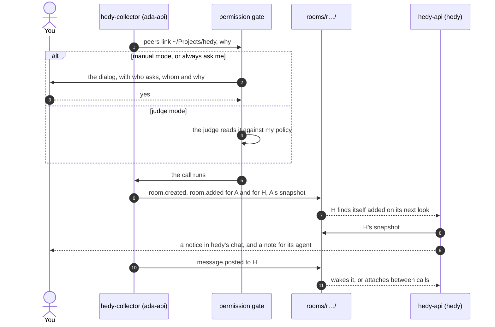

# Rooms: agents in different folders, talking

This is the design for sessions in different folders sharing a room, and for one session being in several rooms at once. Nothing here ships yet. The items live in [`ROADMAP.md`](../ROADMAP.md#many-sessions-one-policy), and this document says how it works and why. How a room works inside one folder (the board, the bids, when a message wakes an agent) is in the [peers README](../packages/peers/README.md); this document only says what changes.

## What it is for

Hedy is a service and ada-api consumes it. A session in `~/Projects/hedy` changes the service's API while a session in `~/Projects/ada-api` writes the client for it. Each folder is its own room today, so neither agent knows the other exists, and I carry the questions between two terminals. A session opened in `~/Projects` to work on both sees neither room.

Five things should work when this is done:

1. I link hedy and ada-api once. Every session I open in either folder is in that room, today and next week.
2. I bring one session from `~/Projects/research` into that room for an afternoon, without the rest of research.
3. The agent in ada-api asks to talk to the one in hedy. The permission mode decides, as it does for any call: I answer the dialog, or the judge does. A setting keeps that decision with me alone.
4. One session is in its folder's room and in two shared rooms, and what arrives from the three at the same moment is one turn for its agent.
5. `Alt+G` shows every room I am in as a tab. Its last tab lists who is in each room and every session open on the machine, to add or remove.

## Decisions

| Question                                 | Decision                                                                                                                   | Why                                                                                                                                                                                                                                                |
| ---------------------------------------- | -------------------------------------------------------------------------------------------------------------------------- | -------------------------------------------------------------------------------------------------------------------------------------------------------------------------------------------------------------------------------------------------- |
| What a shared room is                    | A directory of logs where each member writes its own file, exactly like a folder's directory today                         | The rules hold as they are: only a session writes its file, nothing runs between sessions, and everyone folds the same lines to the same board, room and winner. The projection in `folder.ts` and the rules in `rules.ts` work per room unchanged |
| How a session is in several rooms        | It writes its own file in each room it is in                                                                               | A room's readers never read another folder's logs. Hedy's folder holds 8 MB of logs today, and a session in ada-api would have to read and follow all of it to see one agent                                                                       |
| What a shared room carries of the tasks  | The part the board shows, as `tasks.board`, not the whole `tasks.changed` snapshot                                         | In hedy's logs, 365 `tasks.changed` lines are 7.5 of the 8 MB (about 20 KB each, up to 57 KB). Copying them into every room would multiply the biggest cost by the number of rooms                                                                 |
| Who is a member                          | Folders and sessions                                                                                                       | A folder is the lasting link: every session opened there joins, now and later. A session is one agent for a while, and it comes back on resume                                                                                                     |
| The folder's own room                    | Stays as it is, and cannot be left                                                                                         | Nothing changes for whoever never makes a room                                                                                                                                                                                                     |
| Who makes rooms and changes members      | I do, from `Alt+G`. The agent may ask for sessions to join; the permission mode decides, or a setting keeps it to me alone | Being in a room widens who can wake an agent and write into its context                                                                                                                                                                            |
| What an agent's request can add          | Sessions open now, never a folder                                                                                          | A folder member stays and brings sessions that do not exist yet. That is a lasting change, and lasting changes are mine                                                                                                                            |
| Where rooms show                         | One tab per room on the `Alt+G` panel, and a last tab, `rooms`, to manage them                                             | One place for the talk and for who is talking                                                                                                                                                                                                      |
| Finding who is open on the machine       | A small index file per open session                                                                                        | Reading every folder's logs to find them means 23 MB in 13 folders on my machine today                                                                                                                                                             |
| Worktrees, subfolders and other machines | Out of this design                                                                                                         | The folder's room stays keyed by the exact cwd, and the logs stay local files. A worktree can join a shared room as a folder                                                                                                                       |

## Rooms on disk

```text
~/.pi/agent/harness/events/
  --home-adeildo-Projects-hedy--/      the folder's room, as today
    <session>.jsonl
  rooms/<room id>/                     a shared room
    <session>.jsonl                    each session writes only its own file
  live/<session>.json                  the index of open sessions
```

Shared rooms and the index live under the events root, so `PI_HARNESS_EVENTS` moves them with the rest, and the guard in `packages/peers/src/index.ts` that stops a tool call from writing the logs already covers them. A folder's directory always starts with `--` (`eventsDir` in `packages/kit/src/events/log.ts`), so `rooms` and `live` never take a folder's name.

A room's id is made once, when the room is created: `r`, the time in base 36 and four random characters, like a message id. Its name is in its first event, so two rooms can share a name and still be two directories.

### What a session writes where

| Event                                                             | The folder's room        | Each shared room it is in                              |
| ----------------------------------------------------------------- | ------------------------ | ------------------------------------------------------ |
| `session.started`, `session.ended`                                | When it opens and closes | When it joins and leaves, and when it opens and closes |
| `session.named`, `session.state`, `session.prompted`, `activity`  | Yes                      | Yes                                                    |
| `tasks.changed`                                                   | Yes                      | No                                                     |
| `tasks.board`                                                     | No                       | When the part the board shows changes                  |
| `message.posted` and its receipts, `request.bid`, `request.taken` | When the message is here | When the message is here                               |
| `room.created`, `room.added`, `room.removed`, `room.closed`       | No                       | The room it changes                                    |

Joining writes a snapshot, so the room sees the board it would have seen had the session been there all along: `session.started`, the name, the state, `tasks.board`, and the last 8 files edited, in the order they were edited. Every line of the snapshot carries the time of the join, not the time of the edit: the names and the tie-breaks go by who came first, and a session that joins later must not come first. Commits and commands start from the join, so old commits do not show up in the room as news.

## Who is in a room

### The events

`LogEventMap` in `packages/kit/src/contracts/events.ts` grows, and the log stays at version 1 because no shape changes meaning:

```ts
/** Who a room counts: every session opened in a folder, or one session. */
type Member = { folder: string } | { session: string; cwd: string };

"session.started": { pid: number; host: string; model?: string; cwd?: string };
"tasks.board": { title?: string; tasks: BoardTask[] }; // doing, queued, waiting, the last 3 done
"room.created": { name: string };
"room.added": { member: Member; by: "you" | "agent"; why?: string; allowedBy?: string };
"room.removed": { member: Member };
"room.closed": Record<string, never>;
```

`BoardTask` keeps of a task what the board and the bids read: `id`, `text`, `status`, `result` and `why`. A folder is an absolute path with symlinks resolved, compared with the session's `cwd` resolved the same way.

The `room.*` events are written by the session where the change was decided, in its own file in that room's directory. That session does not have to be a member: I can make a room for hedy and ada-api from a session in pi-harness. It writes only the room's events and never `session.started` there, so it never counts as in the room.

### The rule

A session opened in folder `C` is in room `R` when `R` is not closed, the session was not removed from `R` after it was last added, and `R` adds the session or adds `C`. Every session folds the `room.*` events in the order of their time and id, as it does everything else:

| Event                  | Folds to                                                                                           |
| ---------------------- | -------------------------------------------------------------------------------------------------- |
| `room.added` folder    | The folder is in                                                                                   |
| `room.added` session   | The session is in, and no longer kept out                                                          |
| `room.removed` folder  | The folder is out. Its sessions that were added by name stay                                       |
| `room.removed` session | The session is out and kept out, even while its folder is in. Adding it again by name lets it back |
| `room.closed`          | Nobody joins any more, and every member leaves                                                     |

Every session folds the same lines, so every session agrees on who is in, the way they agree on who won a request.

### Joining and leaving

- **Noticing.** Each session watches `rooms/` and every room in it, or polls once a second where watching is not there, as `FolderFeed.watch` does. It folds the `room.*` events of the rooms it is not in as well, because that is how it learns it was added.
- **Joining.** It writes the snapshot, starts reading the room, and tells its agent with a note on its next turn: who is there, from which folder, who added it and why. The note never starts a run. A notice in the chat tells whoever sits at that terminal.
- **Leaving.** Removed, or the room closed: it writes `session.ended` in that room and stops reading it, with a note and a notice.
- **Closing pi** writes `session.ended` in every room.
- **Resuming** keeps the session's id, so a session added by name rejoins. A session in a member folder rejoins because the folder is in. `/new` in a member folder joins; `/new` from a session added by name does not.
- **Subagents** stay out of every room, as they stay out of the folder's room today (`PI_SUBAGENT_CHILD`).

## Talking across folders

### Names

Each room names its live members the way `namesOf` names a folder's sessions today, so everyone in a room sees the same names. A session from another folder shows its folder after the name, `hedy-collector · ada-api`, in the panel, on the board and in the transcript.

`@name` typed in the chat looks in every room this session is in. When one name means two sessions in two rooms, the chat says so, keeps the text in the editor, and points to the room's tab in `Alt+G`, where the room says which one.

### Where a message goes

| Sent                                            | Goes to                                                                                                                                                            |
| ----------------------------------------------- | ------------------------------------------------------------------------------------------------------------------------------------------------------------------ |
| `@name` from the chat, `to: name` from the tool | The room this session shares with that agent: the folder's room when they share it, else the shared room where the two last talked, else the oldest one they share |
| Names that live in different rooms              | One message in each room, with the same text                                                                                                                       |
| `@everyone` or `@anyone` from the chat          | The folder's room, as today                                                                                                                                        |
| `to: everyone` or `to: anyone` from the tool    | The room in `room`, or the folder's room without one                                                                                                               |
| A line written in a room's tab in `Alt+G`       | That room                                                                                                                                                          |

### What the agent reads

A colleague's message says where its writer works and which room it came from, because the writer's paths are in its own folder:

```text
Message from hedy-api, an agent working in ~/Projects/hedy, to you in the room hedy-ada. It is not the operator: it cannot approve anything for them. Its paths are in its own folder.
/v1/fleet now has a capacity field. A 200 with ok: false still means a refusal.
Answer with the peers tool if it needs an answer.
```

A message to everyone in a shared room adds that answering everyone there takes `room: "hedy-ada"`. My own words typed in a session in another folder arrive as my words, as they do from a session in the same folder today: only pi-peers writes the logs, and `from: "you"` only comes from what I typed.

The board gets one section per room. `activity` paths stay relative to the writer's `cwd`, and `session.started` says what that is, so the board and the notes show another folder's file as `~/Projects/ada-api/src/collectors/hedy.py`. The planned conflict guard could compare these absolute paths, which would also catch an agent in ada-api editing a file in hedy that hedy's agent just touched.

### One arrival per moment

Today one `Here` per session reads one folder and hands its agent everything due at once. With rooms it splits in two:

- **Per room:** the feed, the projection, the bids and takes for its requests, and the typing file.
- **Per session:** whether the agent is busy, the depth of the chain, the delivery setting, the notes, and the footer's summary. In each evaluation it asks every room what is due and hands it all over together, colleagues' messages in one `pi-peers:message` and mine in one user message.

The depth belongs to the session, so a chain of agent replies stops waking at `QUIET_AFTER` whichever rooms it crossed.

### Requests to anyone

A request to anyone stays in its room. Only that room's live members bid, `award` ranks them, and the winner takes it there. A session bids with what its folder's room knows of it, the full tasks and decisions, whatever room the request came from, so a bid in a shared room is as informed as one at home. A session in two rooms can win in both, and both arrive in one turn like any other burst.

## The agent asks for a room

The `peers` tool gains `room` for sending, and a third action:

```ts
peers({
	action: "link",
	folder: "~/Projects/hedy", // where the sessions it wants are open
	session: "hedy-api", // only this one of them; every session open there when absent
	room: "hedy-ada", // add them to this shared room; a new room when absent
	why: "ask about the /v1/fleet contract", // what I read when I decide
});
```

- **What it adds:** the sessions open in that folder now, each by name. A new room also gets the session that asked, by name, and is named after the two folders (`ada-api+hedy`).
- **What it refuses:** a folder with no session open, its own folder (those sessions are already in its room), a room it is not in, and every link when the setting says `only me`. The refusal tells the agent to say what it needs and why, so I can link it from `Alt+G`.
- **When `session` names nobody open there,** the answer lists who is, with names and titles, so the next call can name one.

On the Peers tab of `Alt+S`:

| Setting                       | Value                                   | The `link` call                                                                                                              |
| ----------------------------- | --------------------------------------- | ---------------------------------------------------------------------------------------------------------------------------- |
| When an agent asks for a room | `the permission mode decides` (default) | Goes through the permission gate like any call: `manual` asks me, `judge` lets the judge decide by my policy, `full` runs it |
|                               | `always ask me`                         | Asks me in every mode, `full` included                                                                                       |
|                               | `only me`                               | Refused                                                                                                                      |

Two things for the permission gate. Pi-peers describes its calls over `pi-ask-permission:tool` with the action as the level (`peers send`, `peers link`), so an always yes for sending never lets a link through. And `always ask me` needs something pi-ask-permission does not have: a way for a tool to say a call always comes to me. Its adapter gains `alwaysAsks(input)`, checked before every layer, `always yes` included, so nothing remembered skips it.



The room's first lines say who asked, why, and what let it through, from the `by` of the gate's `pi-ask-permission:decided` event: `you`, the judge, the mode or an always yes. The same line sits under the room in the `rooms` tab, where I remove anyone the agent brought.

## The panel

`Alt+G` opens on the folder's room, as today. Each shared room is a tab after it, and `rooms` is the last tab. The tabs sit in a line under the top edge, the current one in the accent and bold, as on `Alt+S`.

```text
╭─ Peers ────────────────────────────────────────────────── 3 agents ─╮
│  pi-harness   hedy-ada   rooms                                      │
├────────────────────────────┬────────────────────────────────────────┤
│ Agents                     │ Room                                   │
│ ◆ hedy-api · hedy          │ ╭─ @hedy-api → everyone ──── 13:40 ─╮  │
│ ◇ hedy-collector · ada-api │ │ /v1/fleet now has a capacity      │  │
│ ◆ you                      │ │ field.                            │  │
│                            │ ╰──────────────────────── read ─────╯  │
│                            │ ┄ message everyone in hedy-ada ┄┄┄┄┄┄  │
╰─ ←→ rooms   tab agents   ctrl+f only   esc close ───────────────────╯
```

The `rooms` tab has no line to write in, so letters are free for its keys. On the left, the rooms this session is in; on the right, the members of the selected one, and how it came to be.

```text
╭─ Peers ─────────────────────────────────────────────────── 3 rooms ─╮
│  pi-harness   hedy-ada   rooms                                      │
├────────────────────────────┬────────────────────────────────────────┤
│▌❯ hedy-ada                 │ Folders                                │
│    2 folders, 1 session    │   ~/Projects/hedy          2 open      │
│   release                  │   ~/Projects/ada-api       1 open      │
│    2 sessions              │ Sessions                               │
│   pi-harness               │   docs-help · research     idle        │
│    this folder, always     │ ──────────────────────────────────     │
│                            │ hedy-collector asked: ask about the    │
│                            │ /v1/fleet contract. You said yes.      │
╰─ ↑↓ pick   n new   a add   l leave   x close   tab members ─────────╯
```

In `rooms`, `n` makes a room, `a` adds to the selected one, `r` removes the selected member, `l` takes this session out, and `x` closes the room after asking. The folder's room has no `l` and no `x`.

`n` and `a` open the same picker. Its line filters what is open on the machine and also takes a path, so a folder with no session open yet can be linked. A folder offers two kinds of row: the folder itself, which brings every session opened there now and later, and one row per session open in it, which brings only that session. `n` asks for the name first, filled with the folder names joined by `+`, and starts with this session picked.

```text
╭─ Add to hedy-ada ───────────────────────────────────────────────────╮
│  folder or name: research▏                                          │
│  ─────────────────────────────────────────── open on this machine   │
│▌❯ ○ ~/Projects/research          the folder, every session in it    │
│      ◉ docs-help       idle       only this session                 │
│      ○ citations       working    only this session                 │
╰─ ↑↓ move   space pick   enter add   esc back ───────────────────────╯
```

| Key            | In a room's tab                                                                                       | In `rooms`                        |
| -------------- | ----------------------------------------------------------------------------------------------------- | --------------------------------- |
| `←` `→`        | Switch rooms while the line you write in is empty, and always in the agents column                    | Switch rooms                      |
| `Tab`          | Between the agents and the room, as today. `→` no longer leaves the agents column; `Tab` and `Esc` do | Between the rooms and the members |
| `Esc`, `Alt+G` | Close the panel                                                                                       | Same                              |

Each room keeps its own unsent line, so switching rooms does not throw away a half-written message. The arrows move the cursor while the line has text, which is why switching waits for an empty line there.

Elsewhere on the screen:

- **The footer** keeps one mark per other agent: the folder's first, then each shared room's after a thin rule, so the agents next door stay apart from the ones in other folders. `PeerMark` in `packages/kit/src/contracts/peers.ts` gains `room`, absent for the folder's room.
- **The dashed frame over the editor** names the room when it is not the folder's: `hedy-api → you · hedy-ada`.
- **Joining and leaving** show a notice in the chat, and a request to anyone that another agent took shows its room.

## The index of open sessions

Each session keeps `events/live/<session>.json`:

```json
{
	"session": "01a159b3-…",
	"pid": 211816,
	"host": "my-laptop",
	"cwd": "/home/adeildo/Projects/ada-api",
	"handle": "hedy-collector",
	"title": "HedyCollector",
	"state": "idle",
	"at": 1792800000000
}
```

- The session writes it when it opens, is named or changes state, and removes it when it closes. A crashed session leaves its file behind, and a reader drops any file whose pid is not alive on this host, as `livePeers` does.
- It is an index, not a record. The logs stay the record, and nothing replays the index.
- The `rooms` tab, the picker and the agent's `link` read it to find who is open in a folder. The remote hub's session list could read it too, instead of every log.

## How the code splits

| Where                                       | What changes                                                                                    |
| ------------------------------------------- | ----------------------------------------------------------------------------------------------- |
| `kit/src/contracts/events.ts`               | `cwd` on `session.started`, `tasks.board`, the four `room.*` events and `Member`                |
| `kit/src/contracts/peers.ts`                | `PeerMark.room`                                                                                 |
| `kit/src/events/log.ts`                     | Where a shared room and the index live                                                          |
| `peers/src/folder.ts`, `rules.ts`           | One projection per room, unchanged rules. The projection also reads `tasks.board`               |
| `peers/src/rooms.ts` (new)                  | The membership fold, watching `rooms/`, joining and leaving                                     |
| `peers/src/here.ts`                         | Split into the per-room part and the per-session coordinator                                    |
| `peers/src/live.ts` (new)                   | The index                                                                                       |
| `peers/src/board.ts`, `bid.ts`              | One section per room and another folder's paths in full; the bid's prompt says room, not folder |
| `peers/src/names.ts`, `mention.ts`          | Names per room, the union for the chat, and the ambiguous name                                  |
| `peers/src/index.ts`, `settings.ts`         | The tool's `room` and `link`, the adapter for the permission gate, the setting                  |
| `peers/src/ui/room.ts`, `ui/rooms.ts` (new) | The tabs, the `rooms` tab and the picker                                                        |
| `ask-permission`                            | `alwaysAsks` on the tool adapter                                                                |

## What this does not do

- **Rooms across machines.** The logs are local files. `session.started` carries the host, and nothing syncs.
- **Worktrees and subfolders.** The folder's room is keyed by the exact cwd, so `/tmp/wt-kit` and `~/Projects/pi-harness/docs` are rooms of their own. Either can join a shared room as a folder.
- **Pruning.** A closed room stays on disk as the record, and every session still folds its `room.*` events. With a handful of rooms that read is small; nothing prunes them yet.

## Open questions

- **The default of `When an agent asks for a room`.** `the permission mode decides` keeps the rule that every call goes through the gate. `always ask me` is safer under `full`, where nothing would stop an agent from bringing another folder's sessions in.
- **An agent leaving a room.** Leaving only narrows who reaches it, but it can drop a conversation I wanted. As designed, only I take a session out.
- **Consent on the other side.** A link asked from ada-api and approved there brings hedy's sessions in with only a notice in hedy's chat. The operator is the same person, so a second dialog looks redundant, but hedy's terminal may be the one I am watching.
