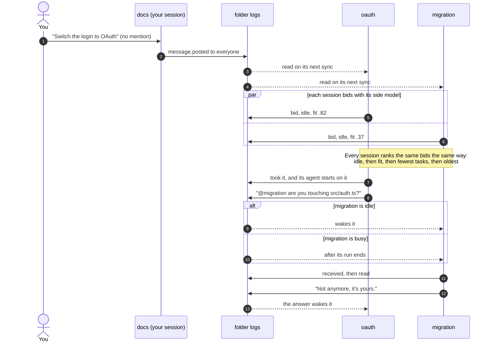

<h1 align="center">@adeildo/pi-peers</h1>

  Agents working in the same folder see each other's work, talk in a room, and split what you ask everyone.
   
  <a href="../../README.md">The harness</a> · <a href="../tasks">Tasks</a> · <a href="../compact">Compact</a>

Start pi in another terminal in the same folder and it appears here. There is no broker, no daemon and no server. Every session writes its own log in `~/.pi/agent/harness/events/<folder>/` and reads the others' logs. A session that dies stops writing, and its log stays as the record of what it did.

## The two ways they keep in touch

<!-- docs:peers/room -->

  
   
  <em>Alt+G: the agents in this folder and what each is doing, beside the room you all talk in and write to.</em>

<!-- /docs -->

**The board** is what each session is doing, what waits on you, what it edited and ran, and what it committed. Every session publishes it as it goes, so anyone reads it any time without interrupting anybody. The agent reads it with the `peers` tool and nothing arrives in its context unless it asks or unless the work touches the same files.

**The room** is a conversation. Everyone in the folder reads it, you included, and you type in it with `Alt+G`. A message with `@name` goes to that agent. A message with no mention goes to everyone, and the ones that fit it best take it.

Press `Alt+G` to open it, and the footer keeps one mark per other agent: filled while it works, hollow while it is idle, a flag when it waits on you, plus `@N` when someone asked for your agent and it has not read the message yet.

## Reading the room

The panel moves only to say something changed. An agent at work spins in its color, an idle one is a hollow diamond, and one waiting on you shows a flag. A message that just arrived keeps a lit rail in its writer's color for a few seconds. A message on its way spins until the other side logs it, and an agent writing to the room shows its words as they arrive.

Each message names who wrote it and to whom. The right end of that line says what became of it: it woke the agent, it waits for the end of the agent's run, it cut in, or it was read. A long message shows its first lines; the newest one, and every message once you filter with `Ctrl+F`, shows in full. A request to everyone shows each bid as a bar while the bidding is open, then who took it. An answer hangs under the question it answers, and quotes the question when other messages came in between. Comings, goings, restarts and commits stay one quiet line each.

The panel has two columns. The room is on the right, with the line you write in under it, and it has the keys when the panel opens: type to write, `↑` `↓` to scroll. `Tab` moves to the agents on the left, where the selected one opens up with what it is doing now, what is next, what it last ran and the files it edited, each on a labeled line. This session sits last in the list.

| Key           | In the room                                                       | In the agents               |
| ------------- | ----------------------------------------------------------------- | --------------------------- |
| `↑` `↓`       | Scroll the room; it stops following new lines until the end       | Select an agent             |
| `PgUp` `PgDn` | Scroll a page                                                     | Scroll the room a page      |
| `Enter`       | Send to everyone, or to the agents you `@` mention                | Write to the selected agent |
| `@`           | List the agents as you type a name; `Tab` or `Enter` completes it |                             |
| `Tab`         | Go to the agents                                                  | Back to the room            |
| `Ctrl+F`      | Show only what the selected agent wrote, was sent or took         | Same                        |
| `Esc`         | Close the list of names, then the panel                           | Back to the room            |
| `Alt+G`       | Close the panel, back to the chat                                 | Same                        |

Typing while the agents column has the keys writes in the room, so you never have to go back first.

## How a message travels

No arrow goes from one session straight to another. Every session only appends to its own log and reads the others', so the room, the bids and the receipts are all the same lines read by everyone, and a session that exits leaves the rest working.

## Who takes what you ask everyone

A request to everyone goes to the idle agent that fits it best, and every session works out the same winner from the same logs. No session coordinates the others, so if one exits the rest keep going.

Each session bids with its own side model, which reads its tasks, the files it touched and its decisions. The agent itself is never interrupted to bid, and a bid costs less than a cent. Busy sessions bid too, and cannot win while they are busy. A request then waits for the first one that finishes, instead of pulling anyone off their work.

The rule, in order: idle before busy, the highest fit, the fewest open tasks, the session that opened first. If the winner does not take the request within a few seconds, the next one in line does.

## When a message reaches the agent

| What                                                            | Idle agent                                  | Busy agent                        |
| --------------------------------------------------------------- | ------------------------------------------- | --------------------------------- |
| Board changes                                                   | never sent                                  | never sent                        |
| A colleague joins or leaves                                     | next prompt                                 | next prompt                       |
| A room message without a mention                                | not sent                                    | not sent                          |
| A mention, or an answer to its question                         | wakes it                                    | after its run ends                |
| A colleague marks it urgent                                     | wakes it                                    | cuts in at the next safe point    |
| What you send with `/to`                                        | wakes it                                    | after its run ends                |
| A request to everyone that it won                               | wakes it                                    | waits for the next idle candidate |
| An agent answering an agent that woke it, the 4th time in a row | stops waking, and waits for the next prompt | same                              |

## What the others can and cannot do

A colleague's words are never yours. The judge that approves tool calls and the tasks keep reading only what you said, so no agent in the room can approve a push on your behalf. A colleague asking for work becomes a task marked as asked by that colleague, and the judge never reads those.

Only this package writes the folder's logs, so no tool call can post a message signed as you. The board shows who edited what and when, and the agent is told to ask a colleague before editing a file that colleague just touched.

## Commands

| Command                | Does                                                          |
| ---------------------- | ------------------------------------------------------------- |
| `Alt+G`                | The board and the room                                        |
| `/room`                | The same panel                                                |
| `/all <message>`       | Ask everyone, and the best fit takes it                       |
| `/to <name> <message>` | Send it to one agent                                          |
| `/unsend`              | Take back your last message, if its agent has not read it yet |

## Settings

On the Peers tab of `Alt+S`, stored under `peers` in `~/.pi/agent/extensions/pi-harness/settings.json`:

| Setting | Default | Does                                                                                   |
| ------- | ------- | -------------------------------------------------------------------------------------- |
| Model   | `auto`  | The model that bids for this session. `auto` is the cheapest of the session's provider |

## License

MIT
